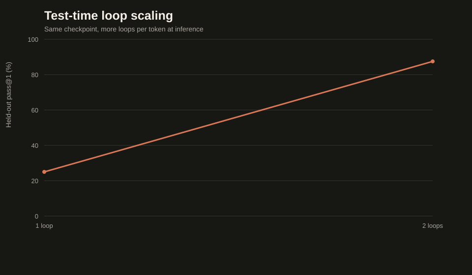

# gpt6-astra-mini — a Looped Transformer, From Scratch

A teaching-scale implementation of the **recurrent-depth ("looped transformer")** architecture reported behind OpenAI's GPT-6 Astra: a shared transformer stack applied multiple times — extra thinking per token, zero extra weights — with per-token depth policies, test-time loop scaling, and per-pass KV caches. Byte-level, deterministic, fail-closed, receipt-audited; CUDA / MPS / CPU.

Grounded in Sebastian Raschka's "GPT-6 Astra, Looped Transformers, and Hidden Reasoning" (Sep 2026) and the research it surveys: Nanbeige4.2, Universal Transformers, Ouro, Mixture-of-Recursions, latent reasoning (Geiping et al.), and SMELT. Every concept maps to code — see [`LOOPING.md`](LOOPING.md).



## Headline result (real runs, receipts included)

| Measurement | Result |
|---|---|
| **Test-time loop scaling** | Same checkpoint, 1 → 2 loops: held-out pass@1 **25% → 87.5%**; `return x + 2` becomes the correct `return x + 1` |
| Pretraining (150 steps, loop counts randomized) | loss 5.62 → 0.21 on compositional programs |
| Coding benchmark after brief SFT | 7/8 families solved greedily |
| Self-improvement ladder | repaired the failing family from 4 self-verified programs (`text[:::-1]` → `text[::-1]`) — and catastrophically forgot 7 others (measured, not hidden) |
| Looped vs deep at this tiny scale | vanilla wins both matchings (consistent with MoR Figure 11); reported as-is |

## Architecture (~14.6M parameters)

```text
bytes → embedding → first block          (Layer 0)
      → LOOP ×2, shared weights:
            state = proj([anchor ; state])   (latent-reasoning re-injection)
            state = shared stack ×6 blocks   (same weights every pass)
      → depth policy picks each position's pass:
            fixed · exit gate (Ouro) · router (MoR)
      → last block (Layer L−1) → RMSNorm → tied LM head
```

16 block applications from 8 distinct blocks. The KV cache is separate per (pass, block) — sharing halves it but hurts quality (Nanbeige's finding), and cached decoding is test-verified identical to full recomputation.

## Quick start

```bash
cd gpt6-astra-mini
python3.12 -m venv .venv
source .venv/bin/activate        # Windows: .venv\Scripts\activate
python -m pip install -r requirements.txt
python -m pytest -q              # 30 tests
```

## Run everything (Windows batch; bash twins in scripts/)

```bash
rem 1. pretrain with randomized loop counts (about 6 min CPU)
run_cpu.bat scripts\train_pretrain.py --output runs\pretrain-001 --steps 150 --checkpoints 50,100,150 --batch-size 16 --randomize-loops --seed 42

rem 2. adapt to the coding format (answer-only SFT)
run_cpu.bat scripts\train_sft.py --initial-checkpoint runs\pretrain-001\checkpoint-0150 --output runs\coding-sft-001 --steps 60 --seed 7

rem 3. the test-time loop-scaling curve
run_cpu.bat scripts\evaluate_loop_scaling.py --checkpoint runs\coding-sft-001\checkpoint-0060 --split confirm --per-family 1 --output artifacts\receipts\loop-scaling.json

rem 4. recursive self-improvement on the failing family
run_cpu.bat scripts\train_self_improve.py --initial-checkpoint runs\coding-sft-001\checkpoint-0060 --output runs\self-improve-001 --families-ladder reverse --seed 73

rem 5. matched-budget experiments + analysis
run_cpu.bat experiments\looped_vs_deep.py --output artifacts\experiments\looped-vs-deep --seeds 11,22
run_cpu.bat experiments\analyze_loop_experiments.py --results artifacts\experiments\looped-vs-deep\results.json --higher-is-better

rem 6. charts from receipts
run_cpu.bat scripts\make_charts.py --output artifacts\charts --pretrain-receipt runs\pretrain-001\training-receipt.json --loop-scaling-receipt artifacts\receipts\loop-scaling.json
```

## The three depth policies

| Policy | Origin | Mechanism |
|---|---|---|
| `fixed` | Nanbeige / Astra rumor | every position takes the last pass |
| `exit_gate` | Ouro + Universal Transformer | per-pass gate; cumulative probability ≥ threshold picks the supplying pass (soft-train, hard-infer) |
| `router` | MoR token-choice | one routing decision per position from the anchor |

Try one: `--depth-policy exit_gate`. Policies change which representation is read, not how much compute runs (Ouro's own caveat); real savings need MoR-style KV sharing, documented as future work.

## Evaluation

```bash
run_cpu.bat scripts\evaluate.py --checkpoint ... --split confirm --per-family 1 --loops 2 --output runs\eval.json
run_cpu.bat scripts\evaluate_passk.py --checkpoint ... --split confirm --samples 8 --output runs\passk.json
```

`--loops k` is the test-time compute dial (validated against the checkpoint's maximum).

## Research experiments

- `experiments/looped_vs_deep.py` — param-matched and application-matched depth comparisons on held-out compositional structures.
- `experiments/loop_depth_policy.py` — fixed vs exit-gate vs router at matched budgets.
- `experiments/analyze_loop_experiments.py` — paired exact sign tests + Holm correction.
- RLOO post-training with executable reward: `scripts/train_rl.py`.

## Slides

```bash
python slides/serve_slides.py --port 8765
# open http://127.0.0.1:8765/slides/slides.html
```

## Repository map

- `astra_mini/model.py` — looped stack, sandwich layout, re-injection, per-pass KV caches
- `astra_mini/depth.py` — the entire policy design space in 84 lines
- `astra_mini/tasks.py` — compositional multi-step corpus + frozen coding splits
- `astra_mini/evaluator.py` — fail-closed AST gate + executable verifier
- `astra_mini/runtime.py` — checkpoints, device, cached batched generation
- `scripts/` — pretrain, SFT, RLOO, self-improve, evaluate (×3), charts
- `experiments/` + `artifacts/` — matched studies, analyzers, receipts, charts
- Docs — [`LOOPING.md`](LOOPING.md) (concept→code map), [`TUTORIAL.md`](TUTORIAL.md), [`REPORT.md`](REPORT.md), [`EXAMPLES.md`](EXAMPLES.md), [`IMPLEMENTATION_PLAN.md`](IMPLEMENTATION_PLAN.md)

## Design rules

- **Determinism** — explicit seeds; tasks from pure integer hashes.
- **Fail-closed** — no overwrites; NaN hard-fails; unknown splits/loops rejected.
- **Receipts** — versioned JSON with SHA-256 weight hashes everywhere.
- **Honesty** — null results and interference are results; they are reported, not spun.

## Limitations

~14.6M parameters, 192-byte context, synthetic programs, tiny-scale single-seed comparisons. Whether looping beats deep at matched budgets requires larger scale (the literature says yes; this repo's tiny runs say vanilla). The Astra connection is a rumor this repo treats as inspiration, not fact.

## License

MIT.
